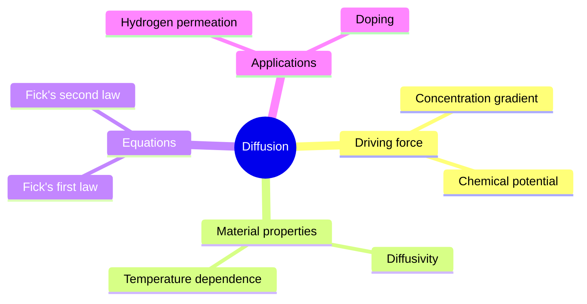

# The ten strategies

How to run each strategy. Read a strategy's section before running it. The
examples use diffusion; adapt them to the learner's topic. The order here is
the order of the original list. The sequence order is in
[sequence.md](sequence.md).

Each section has the same parts:

- **What it is:** the strategy in one or two lines.
- **Run it:** what Claude does, step by step.
- **Produces:** what to save to `notes.md` (or show in the chat).
- **Example:** one prompt or result.
- **Learn more:** the only link to offer for this strategy.

---

## 1. ELI5 (explain like I'm five)

**What it is:** a plain-language explanation built on a familiar example.
Use it for an intuitive first pass at a new topic.

**Run it:**

1. Explain the idea in at most about 150 words, with one everyday analogy.
   Use no jargon, or define each term in a few words the first time.
2. Add one line on where the analogy stops working, so the simple picture
   doesn't become a misconception later.
3. Ask the learner to write the main idea in one sentence, in their own words.
   Then wait.
4. Tighten their sentence with them if it's vague or wrong. Don't replace it
   with yours.

**Produces:** the one-sentence idea, in the learner's words. In the sequence,
this goes into `progress.md` and is refined as the learner progresses.

**Example:** "Explain diffusion like I'm five. Why does a drop of food
coloring spread through water?"

**Learn more:** [Dictionary.com: ELI5](https://www.dictionary.com/culture/slang/eli5)

---

## 2. The 80/20 rule

**What it is:** start with the few ideas that unlock the most understanding
or solve the most common problems. It's a rough rule of thumb, not a
measurement.

**Run it:**

1. From the one-sentence idea and the learner's goal, pick 3–5 core concepts.
   These are the ones they need to explain that sentence properly and to
   solve the most common problems.
2. For each, give one line on why it's core.
3. List what you're deliberately postponing, so the learner knows it exists
   and isn't lost.
4. Ask the learner to confirm, swap or add before moving on.

**Produces:** a "Learn first" list and a "Later" list.

**Example:** learn concentration gradients, diffusivity and Fick's first law
before studying specialized diffusion models.

**Learn more:** [Swiss Association for Quality: the Pareto principle](https://www.saq.ch/en/toolbox/p/pareto)

---

## 3. Make sticky notes

**What it is:** one short question per note, answered from memory before
checking the answer hidden on the back.

**Run it:**

1. Write one idea per note. The prompt is a question, not a statement, and is
   answerable in under a minute.
2. Keep the answer short: one line, an equation, or a sketch described in
   words.
3. Prefer "why" and "what happens if" prompts over bare definitions once the
   definitions are known.
4. Save each note with `scripts/sticky_notes.py add` (see SKILL.md, Phase 3).
   For a review, ask the prompt, wait, then reveal and mark the note.

**Produces:** rows in `sticky-notes.csv`.

**Example:** "What does the minus sign in Fick's first law mean?" Answer:
flux runs down the concentration gradient, from high to low concentration.

**Learn more:** [The Learning Scientists: retrieval practice](https://www.learningscientists.org/retrieval-practice)

---

## 4. Feynman technique

**What it is:** teach the idea aloud in your own words. When you get stuck,
look up the missing piece and explain it again.

**Run it:**

1. Ask the learner to explain the idea, with notes closed, as if to a
   classmate who is new to it. Then wait. Don't interrupt or fill in gaps.
2. Point to the **first** place the explanation got fuzzy, skipped a step,
   used jargon without explaining it, or was wrong. Quote their words.
3. Ask them to work out or look up that piece. Give a short, targeted
   explanation only if they ask or are still stuck after trying.
4. Ask them to explain the whole thing again. Repeat until it's clear, at
   most three rounds; then save what's still shaky as sticky notes.

**Produces:** the gaps found (with how each was fixed) and the final clean
explanation, in the learner's words.

**Example:** explain how particles moving randomly can still produce a net
flux. If the explanation gets fuzzy, revisit that step.

**Learn more:** [Western University: the Feynman technique (PDF)](https://learning.uwo.ca/pdfs/FeynmanTechnique.pdf)

---

## 5. Make a mind map

**What it is:** the topic in the center, branching out to related concepts,
with links where branches influence each other.

**Run it:**

1. Put the topic in the center. Propose 4–6 main branches and ask the
   learner what they'd add, rename or remove.
2. Add 2–4 sub-branches per branch.
3. List the cross-links: places where one branch influences another. Mark
   each link the learner can't yet explain with `?`. These become targets
   for later steps.
4. Draw it as a Mermaid `mindmap` block. Mermaid mind maps can't draw
   cross-links, so list them under the diagram as "A → B: how".

**Produces:** the Mermaid block and the cross-link list, with `?` marks.

**Example:**



Cross-links: Temperature dependence → Diffusivity (Arrhenius); Diffusivity →
Fick's first law (sets the flux for a given gradient); `?` Chemical potential →
Concentration gradient (why the gradient usually works as the driving force).

**Learn more:** [The Open University: mind maps](https://help.open.ac.uk/notetaking-techniques/mind-maps)

---

## 6. Quiz me

**What it is:** answer questions with notes closed, check the reasoning, and
revisit what was missed.

**Run it:**

1. Ask the learner to close their notes. Ask **one** question, then wait.
2. Mix two kinds of question: recall ("state Fick's first law and define each
   symbol") and application, a situation they haven't seen ("if the wall
   doubles in thickness…").
3. After each answer, say whether it's right and explain any mistake in a few
   lines.
4. Classify each miss with the routing table in SKILL.md: forgot it, couldn't
   explain why, or couldn't explain it clearly.
5. At the end, re-ask each missed question in new words.
6. 5–8 questions is a good default; follow the learner's lead.

**Produces:** a quiz log in `notes.md`:

| # | Question | Learner's answer (short) | Result | Route |
| --- | --- | --- | --- | --- |

**Example prompt from a learner:** "Quiz me on diffusion one question at a
time. Wait for my answer, explain any mistakes, and quiz me again on the ones
I miss."

**Learn more:** [MIT Open Learning: retrieval practice and the testing effect](https://openlearning.mit.edu/mit-faculty/research-based-learning-findings/retrieval-practice-testing-effect)

---

## 7. Make a visual study guide

**What it is:** short explanations combined with graphs, diagrams or worked
examples on one page you can review quickly.

**Run it:**

1. Gather the learner's corrected explanation, the schematic, the key
   equations, one worked example and the common mistakes from the quiz.
2. Write `study-guide.html` as one self-contained page. Use inline CSS and
   inline SVG only, with no external scripts, fonts or images, so it opens
   anywhere and prints on one page.
3. Pair each short explanation with its visual. Define every symbol in each
   equation, with units.
4. Compute plotted values; never draw curves by eye. Use a short
   standard-library `python3 -c` calculation, or an analytic solution, then
   draw SVG polylines with labelled axes and units. If you aren't sure of a
   curve's shape, leave it out and mark it `UNSURE`.
5. Ask the learner to read it and say what's missing or unclear. Then revise.

**Produces:** `study-guide.html`. In chat-only mode, give the same content as
a compact Markdown page.

**Example:** one page pairing Fick's law with an annotated concentration
profile and a worked flux calculation.

**Learn more:** [The Learning Scientists: dual coding](https://www.learningscientists.org/dual-coding/)

---

## 8. Reason from first principles

**What it is:** identify the basic facts and assumptions, then build the
explanation from them.

**Run it:**

1. List the basic facts the explanation rests on (for example, conservation
   of mass, random motion, the geometry) and state each assumption
   explicitly.
2. Build the explanation as a numbered chain. Before each step, ask the
   learner what follows, and wait. Supply the step only if they're stuck,
   then ask them to restate it.
3. End at the result they already know (a law or an equation), so they see
   where it comes from.
4. Keep the assumptions list. Socratic questioning tests it next.

**Produces:** the numbered chain from assumptions to result, and the list of
assumptions.

**Example:** imagine particles hopping randomly in both directions. If one
side has more particles, more will cross from that side on average, so
there's a net flow from high to low concentration.

**Learn more:** [EPFL Graph Search: first principles](https://graphsearch.epfl.ch/en/concept/928779)

---

## 9. Use Socratic questioning

**What it is:** a series of questions that probe the learner's reasoning,
assumptions and evidence, with each answer guiding the next question.

**Run it:**

1. Start from one assumption or claim in the learner's explanation.
2. Ask one question at a time, then wait. Vary the kind of question:
   - clarify: "What do you mean by…?";
   - probe assumptions: "What are you assuming when…?";
   - evidence: "How do you know…?";
   - implications: "If that's true, what follows for…?";
   - alternatives: "What would change if…?"
3. Let each answer pick the next question. Don't lecture. When the learner
   reaches the edge of where an idea holds, name that limit plainly.
4. Stop after 4–6 questions per assumption, or when the limit is clear.

**Produces:** a table of each assumption, why it holds, and where it breaks
down.

**Example:** "What assumption gives me a linear concentration profile? What
happens if diffusivity varies across the material?"

**Learn more:** [University of Connecticut: Socratic questions](https://cetl.uconn.edu/resources/teaching-your-course/leading-effective-discussions/socratic-questions/)

---

## 10. Make a schematic

**What it is:** draw the essential parts of a system and label how they
connect or interact.

**Run it:**

1. Ask the learner to describe or sketch the system first; a photo of a hand
   sketch works if the session can read images. Then critique it.
   Otherwise, draw it and ask them to label it.
2. Include only the essentials: components and boundaries, known quantities,
   unknowns, the direction of each flow, where each boundary condition
   applies, and where measurements are made.
3. Draw it as a labelled text diagram in a code block, which works in any
   viewer. Use a cleaner SVG version in the study guide.

**Produces:** the labelled diagram and a one-line legend.

**Example:** a membrane between two reservoirs:

```text
   Reservoir A        membrane        Reservoir B
   C = C_A       |<---- L ---->|      C = C_B   (C_A > C_B)
                 |             |
                 |  J  ----->  |      net flux, high to low
                 |             |
            x = 0               x = L
```

**Learn more:** [Queen's University: learning through drawing diagrams](https://ojs.library.queensu.ca/index.php/inquiryatqueens/article/view/14708)
